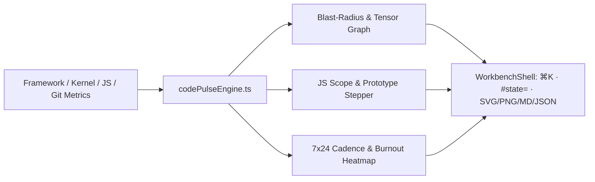

# code-pulse-ext

[](https://omakasekim.github.io/code-pulse-ext/)
[](#plugin-installation)
[](LICENSE)

> **Subsystem/React/Vue/Flutter/TensorFlow Blast-Radius Graph, JS Scope/Closure/Prototype X-Ray & Commit Cadence / 996 Burnout Heatmap** for high-velocity engineering teams.

## Target GitHub Ecosystems

| Ecosystem | Capability in `code-pulse-ext` |
| --- | --- |
| `facebook/react` · `vuejs/core` · `flutter/flutter` | Click any store/widget to trace downstream re-render & constraint propagation hops |
| `torvalds/linux` · `tensorflow/tensorflow` | Kernel `MAINTAINERS` owner impact + live batch-size tensor shape & FP16 VRAM calculator |
| `getify/You-Dont-Know-JS` | Step-by-step Lexical Environment, Closure retention, `[[Prototype]]` delegation, and `this` binding X-Ray |
| `996icu/996.ICU` | 7×24 commit cadence heatmap with after-hours crunch, bus-factor concentration, and SVG badge export |

## Architecture



## Quickstart

```bash
npm install
npm run dev
```

Run tests and production build:

```bash
npm test && npm run build
```

## Plugin Installation

1. **Chrome MV3 Extension (`plugin/`)**: Load `./plugin` unpacked via `chrome://extensions` with Developer Mode enabled.
2. **CLI Companion**:
   ```bash
   node plugin/cli.mjs --demo
   ```

## License

[MIT](LICENSE)
